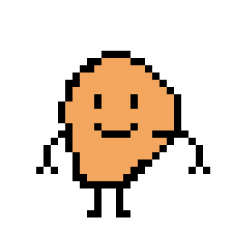

# 🎮 Tamagotchi RPG (Web & Python)

<p align="center">
  
</p>

<p align="center">
  <strong>Simulador de Mascota Virtual interactivo desarrollado en JavaScript (Web) y Python (Terminal / POO).</strong>
  <br>
  <em>Proyecto desarrollado para portafolio personal de desarrollo de software.</em>
</p>

<p align="center">
  
  
  
  
  
</p>

---

## 📖 Descripción del Proyecto

**Tamagotchi RPG** es una recreación interactiva del clásico juego de mascotas virtuales donde el usuario asume la responsabilidad de cuidar, alimentar, asear y entretener a un compañero virtual ("Papa RPG").

El proyecto combina dos implementaciones complementarias que demuestran competencias de programación tanto en desarrollo frontend como en lógica de backend/scripts con Python:
1. **Versión Web:** Interfaz gráfica responsiva y dinámica construida con HTML5, CSS3 moderno (animaciones, layouts) y JavaScript Vanilla (gestión de estado, temporizadores, animaciones del sprite y persistencia con `localStorage`).
2. **Versión Python:** Implementación con **Programación Orientada a Objetos (POO)** que modela el comportamiento, cálculo de estados, barras de progreso visuales en la consola de comandos, persistencia en archivos JSON y servidor web integrado.

---

## ✨ Características Principales

### 🌐 Interfaz Web
- **Ciclo de vida en tiempo real:** Disminución progresiva del bienestar de la mascota mediante bucles de temporización (`setInterval`).
- **4 Necesidades fundamentales:**
  - 🍔 **Hambre:** Requiere alimentación constante.
  - 💤 **Sueño:** Posibilidad de poner a dormir a la mascota para recargar energía.
  - 🧼 **Suciedad:** Efecto visual de suciedad cuando el nivel es elevado; baño completo disponible.
  - 🎮 **Aburrimiento:** Actividades de juego para mantener alto el ánimo.
- **Retroalimentación visual y animaciones:** Reacción de la mascota con animaciones (`bounce`, `wiggle`, estado dormido y estado crítico).
- **Persistencia de datos:** Guardado y reanudación automática del progreso mediante la API `localStorage` del navegador.
- **Récords y Game Over:** Registro de tiempo de supervivencia y pantalla de fin de partida en caso de descuido severo.

### 🐍 Edición Python (POO & CLI)
- **Diseño modular:** Clase `Tamagotchi` con métodos bien delimitados para cada acción y cálculo de estado.
- **Visualizador CLI:** Barras de estado con indicadores de color e ilustraciones ASCII dinámicas.
- **Guardado y carga:** Serialización del estado en formato JSON (`partida.json`).
- **Servidor local incluido (`server.py`):** Servidor HTTP nativo en Python para iniciar la versión web y abrir el navegador en un clic.

---

## 🕹️ Mecánicas de Juego

| Acción | Impacto en Estadísticas | Efecto Especial |
| :--- | :--- | :--- |
| **🍔 Comer** | `-25 Hambre`, `+5 Suciedad` | Rebote alegre de la mascota |
| **💤 Dormir / Despertar** | `-40 Sueño` (gradual), `+5 Hambre` | Atenuación visual y descanso |
| **🧼 Limpiarse** | `Suciedad = 0` | Animación de sacudida y brillo |
| **🎮 Jugar** | `-30 Aburrimiento`, `+8 Hambre`, `+10 Sueño` | Salto de celebración |
| **⏳ Paso del tiempo** | `+3 Hambre`, `+2 Aburrimiento`, `+2 Sueño`, `+1 Suciedad` | Ocurre periódicamente |

> ⚠️ **Condición de Derrota:** Si cualquiera de las necesidades llega al **100%**, la mascota enfermará y la partida finalizará.

---

## 📂 Estructura del Repositorio

```text
Tamagochi-en-Python/
│
├── index.html            # Página de inicio / Punto de entrada principal (GitHub Pages)
├── inicio.html           # Pantalla de bienvenida original
├── inicio.css            # Estilos de la pantalla de bienvenida
├── MenuSeleccion.html    # Menú de navegación (Nuevo Juego, Reanudar, Récords)
├── Seleccion.css         # Estilos del menú de opciones
├── tamagotchi.html       # Pantalla principal del videojuego web
├── tamagotchi.css        # Estilos, layout del escenario, barras y animaciones
├── script.js             # Lógica interactiva en JavaScript (estado, eventos, guardado)
│
├── fondo.jpg             # Imagen de fondo del escenario de juego
├── papa.png              # Sprite principal de la mascota
│
├── tamagotchi.py         # Simulación completa en consola con POO en Python
├── server.py             # Servidor HTTP local en Python para previsualización web
│
├── .gitignore            # Exclusión de archivos confidenciales, temporales y caché
└── README.md             # Documentación detallada del proyecto
```

---

## 🚀 Instalación y Ejecución

No se requieren librerías de terceros (cero dependencias externas). Solo necesitas un navegador web moderno y/o Python 3.

### Opción 1: Ejecutar la Versión Web
1. Abre directamente el archivo `index.html` en tu navegador web preferido (Google Chrome, Firefox, Edge, etc.).
2. O inicia el servidor local en Python:
   ```bash
   python server.py
   ```
   *Se abrirá automáticamente en tu navegador en `http://localhost:8000/index.html`.*

### Opción 2: Ejecutar la Versión en Consola (Python)
Ejecuta el script principal en la terminal:
```bash
python tamagotchi.py
```
Utiliza las opciones numéricas del menú interactivo para interactuar con tu mascota.

---

## 🌐 Despliegue en GitHub Pages

Este proyecto está optimizado para funcionar directamente en **GitHub Pages**:
1. Ve a la pestaña **Settings** de tu repositorio en GitHub.
2. En la sección **Pages** (menú izquierdo), selecciona la rama `main` y la carpeta `/ (root)`.
3. Haz clic en **Save**. En un par de minutos tu juego estará accesible públicamente a través de la URL generada por GitHub.

---